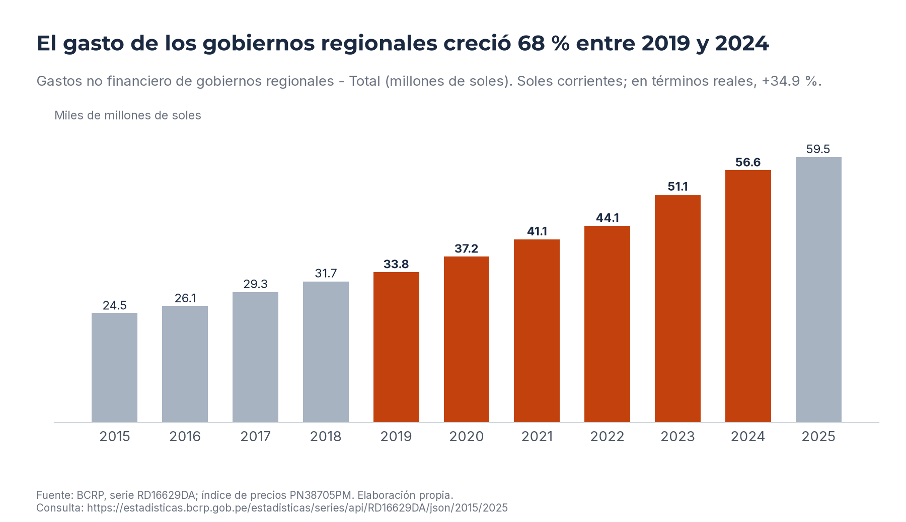
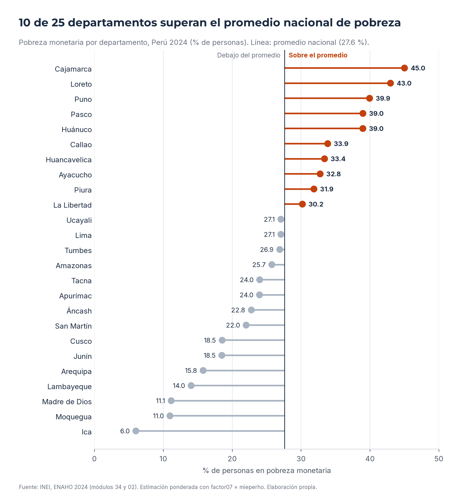
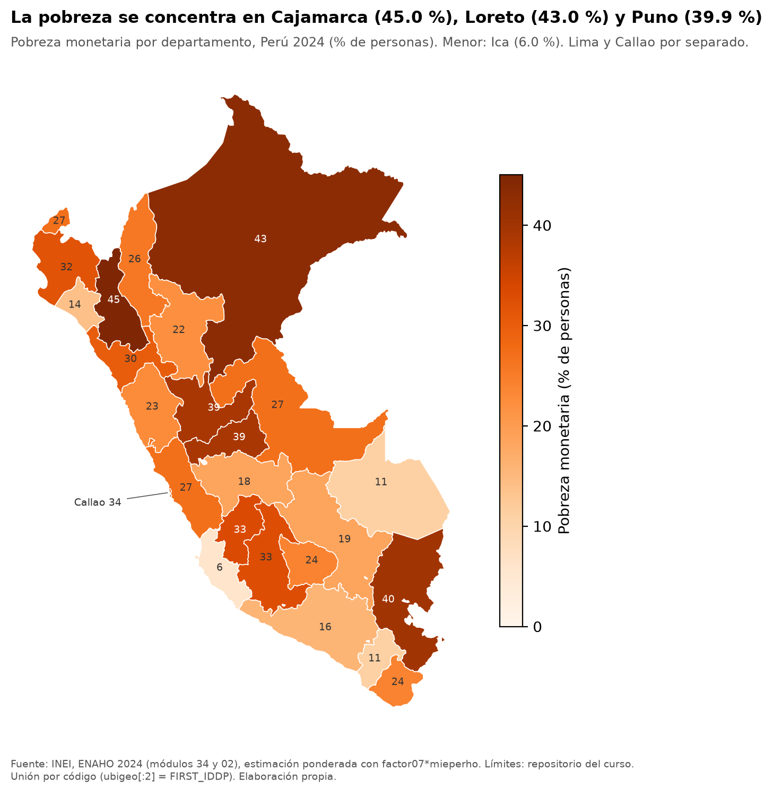
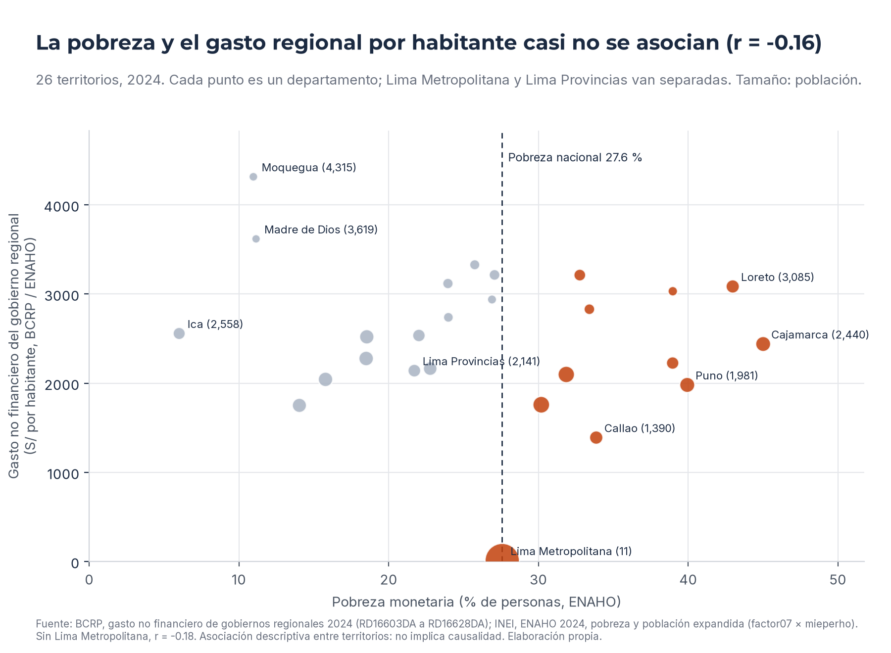

# El gasto regional por habitante de 2024 no fue mayor donde hay más pobreza, aunque el gasto total creció cerca de 35% real desde 2019

Frank Pinares Gutiérrez · 6 de noviembre de 2026 · Tarea 4, Python Intermedio para CCSS y Gestión Pública

## 1. Pregunta de investigación

El presente informe examina si el gasto de los gobiernos regionales por habitante en 2024 fue mayor en los territorios con más pobreza monetaria y cómo evolucionó ese gasto entre 2019 y 2024. El cruce territorial se circunscribe a 2024 y abarca 26 territorios, con Lima Metropolitana y Lima Provincias separadas y con Callao como unidad propia. La evolución 2019-2024 se analiza solo para el gasto regional total, de modo que no se dispone de una trayectoria territorial de la pobreza.

## 2. Fuentes y metodología

Del Banco Central de Reserva del Perú (BCRP) se emplearon, mediante el servidor MCP `bcrp`, el gasto no financiero de los gobiernos regionales por departamento en 2024 (series RD16603DA a RD16628DA), el total anual (RD16629DA, 2015-2025), el gasto no financiero de los gobiernos locales por departamento como complemento (RD16551DA a RD16575DA) y el Índice de Precios al Consumidor de Lima Metropolitana (PN38705PM, diciembre de 2021 = 100) como deflactor. La suma de los 26 territorios coincide con el total del BCRP (56,575.5 millones de soles, RD16629DA, 2024) y no faltan territorios; en los gobiernos locales la suma de los 25 departamentos (39,345.7 millones) difiere del total en menos de una décima de millón.

De la Encuesta Nacional de Hogares (ENAHO) 2024 del INEI se utilizaron los módulos 34 (sumaria) y 02 (miembros), con pobreza ponderada por factor07 × mieperho y población expandida. La skill `limpiando-enaho` aprobó las 15 verificaciones (salidas/validacion.txt), entre ellas la pobreza nacional de 27.58% frente a la referencia del INEI de 27.6%. Las skills `graficando-enaho` (cortes por departamento y por área) y `mapeando-enaho` produjeron las figuras de pobreza. Los datos de ambas fuentes se unen por código de territorio, y el gasto por habitante resulta de dividir el gasto regional entre la población expandida de la ENAHO. La variación real se calcula deflactando con el promedio anual de PN38705PM.

## 3. Resultados

### 3.1 Evolución del gasto regional 2019-2024, nominal y real

El gasto no financiero de los gobiernos regionales pasó de 33,755.1 millones de soles corrientes en 2019 a 56,575.5 millones en 2024 (RD16629DA, 2019 y 2024), lo que equivale a una variación nominal de 67.61% (resumen de RD16629DA, 2019-2024). Ahora bien, los precios de Lima Metropolitana aumentaron 24.23% en el mismo lapso (PN38705PM, promedio anual 2019-2024; salidas/bcrp_resumen_RD16629DA.csv), por lo que la variación real asciende a 34.92%, es decir, cerca de la mitad de la nominal. El gasto creció, además, en cada uno de los años de la serie, sin interrupciones entre 2019 y 2024 (RD16629DA).

### 3.2 Distribución territorial de la pobreza 2024

La pobreza monetaria nacional fue de 27.58% y la pobreza extrema de 5.50% (salidas/indicadores.csv, nivel nacional). Por área, la pobreza rural alcanzó 39.30% y la urbana 24.81% (salidas/indicadores.csv, nivel área). Entre los territorios, los más pobres fueron Cajamarca (45.0%), Loreto (43.0%) y Puno (39.9%), mientras que Ica (6.0%), Moquegua (11.0%) y Madre de Dios (11.1%) presentaron los niveles más bajos (salidas/cruce_territorios.csv). Los 25 departamentos del mapa coinciden con la referencia de la Sesión 16 dentro de la tolerancia de 0.1 puntos (salidas/comparacion_mapa.csv).

### 3.3 Relación entre gasto regional por habitante y pobreza, con y sin Lima Metropolitana

El gasto regional por habitante del conjunto fue de 1,640.7 soles en 2024 (salidas/cruce_resumen.csv, gasto_regional_pc_nacional). Sin considerar Lima Metropolitana, los 10 territorios con pobreza superior al promedio nacional registraron 2,233.5 soles por habitante, frente a 2,433.2 soles en los 15 territorios con pobreza igual o inferior al promedio (salidas/cruce_resumen.csv). Es decir, la mayor pobreza no se acompaña de mayor gasto por habitante; si bien la diferencia es moderada, tiene el signo opuesto al que sugería la pregunta.

La correlación de Pearson entre pobreza y gasto regional por habitante es de -0.16 con los 26 territorios y de -0.18 sin Lima Metropolitana; la de Spearman es de -0.13 y -0.10, respectivamente (salidas/cruce_resumen.csv). Debe considerarse que Lima Metropolitana registra un gasto regional de apenas 115.7 millones de soles (RD16628DA, 2024), equivalente a 11.2 soles por habitante (salidas/cruce_territorios.csv), por lo que resulta atípica; al incluirla en el grupo de pobreza alta (por situarse justo sobre el promedio, con 27.6%), el gasto por habitante de ese grupo cae a 1,210.2 soles (salidas/cruce_resumen.csv). Como complemento, con el gasto de los gobiernos locales la correlación de Pearson es de -0.40 en 25 departamentos (salidas/cruce_resumen.csv), de manera que tampoco allí se observa un mayor gasto donde la pobreza es más alta.

## 4. Visualizaciones

El gráfico del BCRP muestra el ascenso continuo del gasto regional entre 2019 y 2024, nominal y deflactado.

Se aprecia la distancia de cada departamento respecto del promedio nacional de 27.6%.

El mapa reúne los departamentos en cuatro rangos de pobreza, con Lima y Callao ampliados.

Los territorios más pobres no se ubican de forma sistemática en la zona de mayor gasto por habitante; Lima Metropolitana aparece en el extremo inferior.

## 5. Interpretación

Se observa que el gasto regional por habitante de 2024 no está ordenado según la pobreza: hay territorios pobres con gasto alto (Loreto, con 3,085.1 soles y 43.0% de pobreza) y otros con gasto bajo (Puno, con 1,980.9 soles y 39.9%), así como territorios de baja pobreza con los mayores gastos por habitante (Moquegua, con 4,315.2 soles). Siguiendo esto, el patrón coincide más con un gasto elevado en territorios de poca población que con una asignación vinculada a la pobreza, aunque el presente informe no contrasta esa posibilidad. Asimismo, el crecimiento real de 34.92% indica que el gasto regional aumentó en términos agregados, pero no permite saber si lo hizo con mayor intensidad en los territorios más pobres. No puede concluirse ningún efecto del gasto sobre la pobreza ni lo contrario.

## 6. Limitaciones

Se cuenta con una sola ENAHO (2024) frente a una serie de gasto de 2019 a 2024, por lo que no se puede comparar la evolución territorial de ambas variables. El gasto está en soles corrientes, salvo la variación real calculada con el IPC de Lima Metropolitana, que no refleja las diferencias de precios entre regiones. La población proviene de la encuesta (expandida) y no de proyecciones oficiales, y algunos departamentos tienen muestras pequeñas (columna muestra de salidas/cruce_territorios.csv). Los niveles de agregación difieren: el gasto regional corresponde a los gobiernos regionales, mientras que la pobreza describe a toda la población del territorio. Lima Metropolitana es un caso atípico, por lo que se reportan resultados con y sin ella. Finalmente, se trata de una asociación descriptiva entre territorios y no de una relación causal.

## 7. Reproducibilidad

Herramientas MCP `bcrp`: `departamentos` (gastos gobiernos regionales y locales, 2024), `serie` (RD16629DA, PN38705PM) y `resumen` (RD16629DA, 2019-2024). Skills: `limpiando-enaho` (2024), `graficando-enaho` (departamento y área), `mapeando-enaho` e `investigando-peru`. Scripts ejecutados desde la raíz del repositorio:

- `uv run .claude/skills/limpiando-enaho/scripts/limpiar.py --anio 2024`
- `uv run .claude/skills/graficando-enaho/scripts/graficar.py --por departamento` y `--por area`
- `uv run .claude/skills/mapeando-enaho/scripts/mapear.py`
- `uv run .claude/skills/investigando-peru/scripts/cruzar.py --anio 2024`
- `uv run .claude/skills/investigando-peru/scripts/graficar_bcrp.py --codigo RD16629DA --desde 2019 --hasta 2024 --deflactor PN38705PM`

| Cifra del informe | Valor | Origen (serie y periodo, o archivo y fila) |
|---|---:|---|
| Gasto regional total 2019 | 33,755.1 | RD16629DA, 2019 |
| Gasto regional total 2024 | 56,575.5 | RD16629DA, 2024 |
| Variación nominal 2019-2024 | 67.61% | resumen RD16629DA; salidas/bcrp_resumen_RD16629DA.csv |
| Variación de precios 2019-2024 | 24.23% | PN38705PM; salidas/bcrp_resumen_RD16629DA.csv |
| Variación real 2019-2024 | 34.92% | salidas/bcrp_resumen_RD16629DA.csv |
| Pobreza nacional | 27.58% | salidas/indicadores.csv, nivel nacional |
| Pobreza rural / urbana | 39.30% / 24.81% | salidas/indicadores.csv, nivel área |
| Gasto regional por habitante nacional | 1,640.7 | salidas/cruce_resumen.csv, gasto_regional_pc_nacional |
| Pobreza alta / baja (sin 15LM) | 2,233.5 / 2,433.2 | salidas/cruce_resumen.csv |
| Pearson 26 / sin 15LM | -0.16 / -0.18 | salidas/cruce_resumen.csv |
| Gasto de Lima Metropolitana | 115.7 millones | RD16628DA, 2024 |
| Gasto por habitante de Lima Metropolitana | 11.2 | salidas/cruce_territorios.csv, fila 15LM |

## 8. Verificación manual

La presente sección fue completada por el autor después de la ejecución del agente, siendo que las comprobaciones se realizaron el 6 de noviembre de 2026 por un camino distinto al de las herramientas del proyecto: la consulta directa de las tablas publicadas en el portal BCRPData, el cálculo manual de la variación con esos mismos valores y la revisión del archivo de referencia de la Sesión 16 del repositorio del curso. Debe tenerse en cuenta que el portal del BCRP presenta los montos anuales redondeados a enteros, por lo que la diferencia de medio millón de soles en el gasto total corresponde únicamente al redondeo de la publicación.

| Afirmación | Valor del informe | Cómo se verificó | Resultado | Diferencia |
|---|---:|---|---|---|
| Gasto regional total 2024 (RD16629DA) | 56,575.5 millones de soles | Tabla anual de RD16629DA en BCRPData (2019-2024) | 56,576 millones; coincide | 0.5 millones, por el redondeo a enteros del portal |
| Variación nominal 2019-2024 (RD16629DA) | 67.61% | Cálculo manual con los valores del portal: 56,576 / 33,755 − 1 | 0.67608, es decir 67.61%; coincide | Ninguna al segundo decimal |
| Gasto regional de Lima Metropolitana 2024 (RD16628DA) | 115.7 millones de soles | Tabla anual de RD16628DA en BCRPData (2024) | 116 millones; coincide | 0.3 millones, por el redondeo a enteros del portal |
| Pobreza monetaria de Cajamarca 2024 (ENAHO) | 45.0% | Archivo referencias/pobreza_departamento_2024.csv de la Sesión 16 (d2cml-ai/Data-Science-Python) | 45.0%; coincide | Ninguna |
